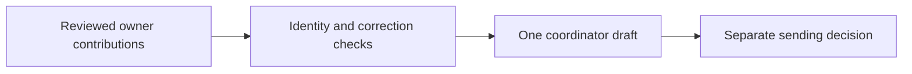

# Grace Gems coordinated cadence



## What it does

Selects team-safe contributions from already-inspected work and composes one
bilingual draft while retaining provenance, missing coverage and delivery state.
It does not write Open Brain memory or connect to its database.

## Prerequisites

An Open Brain workspace for the host workflow, Python 3.11 or later, IANA timezone
data (install tzdata on systems without it), and pytest for tests. The compiler
itself runs locally without a database or API key. Real source access and a private
output destination need existing owner authorization.

## Supported Clients

Codex, Cursor and Claude Code agents able to read local skill files and execute
Python. This is an explicit invocation candidate, not automatic installation.

## Installation

Keep this entire folder at skills/grace-gems-cadence in the checkout. Read SKILL.md
when invoking it; do not copy operational evidence into this public repository.

## Trigger Conditions

An explicit Grace Gems closeout, contribution export or coordinated team-draft
request. Bare Coffee, unrelated work and brain-sync do not trigger it.

## Step-by-step instructions

1. Read SKILL.md and the operating contract below; establish authorized sources,
   business period and a private output location.
2. Have the agent inspect and review a bounded owner projection and source map.
3. Export that owner's contribution with the command below; read back the result.
4. The designated coordinator composes the available contributions once, keeping
   all expected owners and coverage gaps visible.

## Expected outcome

One current contribution per owner and one coordinator's local bilingual draft,
with source/version evidence. Nothing is sent or adopted by running the compiler.

## Troubleshooting

- Stale audience hash: reconcile current evidence and review all fields again.
- Missing source bytes: recover the authorized current source or report the gap;
  never invent a hash or silently omit a missing expected owner.
- Output rejected: choose an explicitly designated absolute private folder outside
  Git checkouts; do not weaken the privacy boundary.

## Provenance

This repository builds on Nate B. Jones / Open Brain. The cadence contribution
keeps its memory boundaries intact. For the original practical systems and guides,
see [Nate's Substack](https://substack.com/@natesnewsletter) and
[Nate's site](https://natebjones.com).

## Operating contract

# Grace Gems coordinated daily draft — review candidate

Jon contributes one audience-reviewed selection from already-inspected work.
One designated coordinator combines owner contributions into one bilingual team
draft. Do not generate independent competing daily emails. No new manual log,
reporting queue or memory writer is introduced.

Preserve Artistic Director project membranes and existing autodream/Open Brain behavior. Client evidence and drafts stay on an explicitly designated private surface outside this public checkout; never put them into global memory, accepted lessons or brain-sync. Creative proposals remain proposals until separately approved.

## Agent workflow

For an explicit Grace Gems closeout, inspect bounded authorized current sources,
reconcile revisions and delivery in existing owning records, then select only
team-relevant outcomes. Do not collect broad personal history. Email/Drive access
requires existing source authority; unavailable access remains a coverage gap.
Do not recover excluded correspondence through other copies or transcripts.
The agent prepares the transient JSON, checks exact current source bytes/provider
readbacks, and reviews wording, bilingual meaning, metadata and links for the
team audience. Nobody is asked to fill in a log. Audience/source labels are review
declarations, not proofs of truth, translation quality or permission.

Export one current owner contribution. Share it with the designated coordinator
only under existing delivery authority. The coordinator explicitly names the
expected owners (Mira, Hannah and Jon for this team), same business date/timezone,
and project, and composes once. Missing contributions stay visible; unavailable
does not mean no work. Corrections use exact references; unresolved variants
remain separate. Read the draft back and resolve meaningful conflicts where
supported. A local Markdown file is not a Gmail draft, upload or sent message.

## Commands

Type this command after the agent has prepared and reviewed the private input:

```sh
python3 skills/grace-gems-cadence/tools/grace_gems_daily.py export --input /private/selection.json --source-map /private/source-map.json --date YYYY-MM-DD --timezone AREA/CITY --project grace-gems --repo-root /absolute/repository --output /private/jon-contribution
```

Only the designated coordinator uses compose:

```sh
python3 skills/grace-gems-cadence/tools/grace_gems_daily.py compose --input /private/mira/current-contribution.json --input /private/hannah/current-contribution.json --input /private/jon/current-contribution.json --date YYYY-MM-DD --timezone AREA/CITY --project grace-gems --expected-owner mira --expected-owner hannah --expected-owner jon --repo-root /absolute/repository --output /private/team-draft
```

Omit unavailable input files while keeping their expected owners. Export writes
`current-contribution.json`; compose writes `current-team-email.md` and
`current-evidence.json`. Output folders must be absolute and outside any Git
checkout. Prior differing bytes remain in private `.history`; unchanged reruns
add nothing. Invalid input preserves current output. File readback establishes
local byte delivery only. The module `skills/grace-gems-cadence/tools/team_contributions.py` implements
the same portable contract in every owner adapter.

## Portable contract

`scripts/team_contributions.py` is the standalone implementation shared with the
client adapters. `team-contribution-v1` contains `owner`, `project`, `date`,
`timezone`, `audience: grace-gems-team`, `basis`, `coverage`, `sources`, `outcomes`
and `review`. Unknown fields are rejected rather than copied into an export.
The basis contains opaque `id`, `version`, `sha256` and timezone-aware
`observed_at`. Sources contain opaque `id`, `version` and `sha256`; the collector
checks original bytes/provider revisions before export. Hashes bind declarations,
not factual truth. Do not export local paths, raw records or private source URLs.
Export requires `--source-map ABSOLUTE_PRIVATE_JSON`, mapping each selected source
ID to an absolute original or exact provider-readback capture. The exporter checks
the current bytes against the reviewed hashes and never copies paths or bodies.
The collecting agent remains responsible for provider freshness and capture scope.

Coverage declares session, repository, email and Drive independently as checked,
unavailable or not_applicable, with exact bilingual limits. Checked means only
the named inspected scope; it is not exhaustive coverage. Each outcome declares
its claim `id`, stable `outcome_id`, stable `artifact_id`, current `revision`,
`event_date`, `category`, `evidence`, `delivery`, `source_ids`, `en`, `zh`,
`uncertainty`, and `supersedes`. Optional fields are reviewed `share_url` and
`carry_forward`. Use opaque identifiers, not personal data or paths.

Delivery states are local, draft, attempted, verified or not_applicable. Verified
requires a version-matching readback source in the claim's source list. Its
`destination`, `version` and `evidence_id` remain explicit even when incomplete.
Local, uploaded, provider-verified and sent claims must never be conflated.
Old progress is rejected; older blockers, decisions and next steps require
explicit carry-forward. Record a late correction on its actual correction date.

Claims merge only when stable outcome/artifact identity and substantive fields
match. Different identities never merge merely because prose matches. Different
assertions under one identity remain unresolved variants with separate provenance.
A correction names exact owner, claim ID and SHA256 in `supersedes`; include the
target claim in the same exchange. Missing targets, changed hashes, cycles and
cross-outcome corrections fail closed. For earlier-day targets, reconcile in the
owning record and export the corrected current-day claim with versioned sources;
do not relabel yesterday's progress. Multiple conflicting replacement claims remain
unresolved. Semantic reconciliation is agent work, not inferred by timestamps.

## Adoption, scheduling and sending

This proposal replaces the earlier independent-email compiler interface; the
unadopted v1 evidence packet is not silently upgraded or relabeled as reviewed.
Existing historical drafts remain untouched. Prepare a new projection from the
current owning evidence. Tests require pytest; run `python3 -m pytest
skills/grace-gems-cadence/tests/test_grace_gems_daily.py` using an external temporary root.

Installation or merge is not personal adoption, business approval, source access,
routine collection, a schedule or sending authority. After explicit adoption,
the owner chooses a business timezone/cutoff and source scope. One coordinator
may be scheduled only when separately authorized; no automatic schedule is
created here. Keep this prompt scoped to contribution export for each owner.

Sending additionally needs the confirmed sender/recipients and an explicit
message approval or bounded standing policy. Reconcile provider message IDs and
history before any authorized retry; an unknown send result must not trigger a
duplicate send. Use existing correspondence preservation. Do not change access
or mailing-list membership. The scripts contain no retrieval or sending API.
Tests establish the exchange/compiler behavior, not real-world time savings,
autonomous source selection, semantic judgment, translation quality or adoption.
